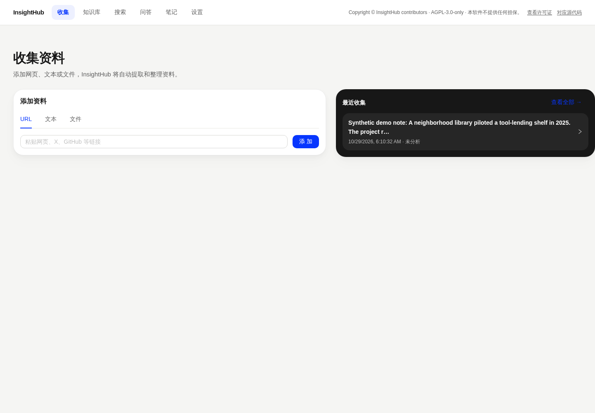
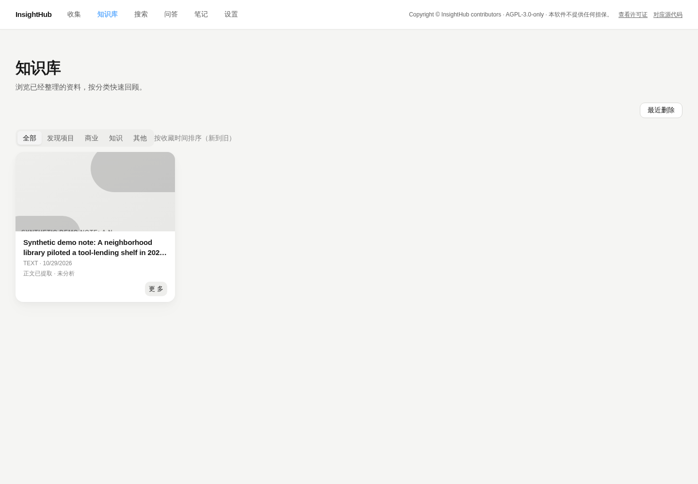
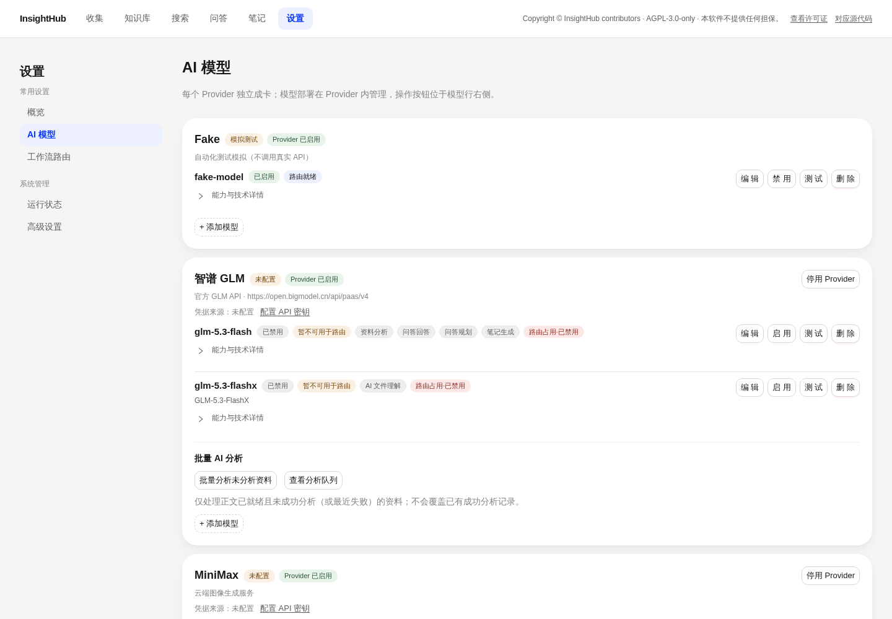

# InsightHub

InsightHub is a self-hosted research and learning workspace for collecting sources, extracting their content, analyzing evidence, and building a searchable personal knowledge base.

## Quick start

For a containerized installation, follow [English installation guide](docs/INSTALL.en.md) or [简体中文安装指南](docs/INSTALL.zh-CN.md). For Windows local installation, see [English local guide](docs/INSTALL-LOCAL.en.md) or [本机安装说明](docs/INSTALL-LOCAL.zh-CN.md). For contribution setup, see [development guide](docs/DEVELOPMENT.md).

The default container deployment keeps PostgreSQL, Redis, uploaded files, exports, and encrypted credentials in persistent volumes. Configure provider credentials in the application after first launch. Model keys are not included in this repository.

Screenshots below come from the isolated v1.0.0 Docker deployment. The one sample source is fictional, and no real model credentials were configured. See [screenshot provenance](docs/assets/screenshots/README.md).

| Collection | Knowledge library | AI model settings |
|---|---|---|
|  |  |  |

## Documentation

| Start here | English | 简体中文 |
|---|---|---|
| Install with Docker Compose | [Install](docs/INSTALL.en.md) | [安装](docs/INSTALL.zh-CN.md) |
| Install locally on Windows | [Local install](docs/INSTALL-LOCAL.en.md) | [本机安装](docs/INSTALL-LOCAL.zh-CN.md) |
| Deploy and operate | [Deployment](docs/DEPLOYMENT.en.md) | [部署运维](docs/DEPLOYMENT.zh-CN.md) |
| AI providers and embeddings | [Models](docs/MODELS.en.md) | [模型与向量检索](docs/MODELS.zh-CN.md) |
| Use the application | [User guide](docs/USER-GUIDE.en.md) | [使用指南](docs/USER-GUIDE.zh-CN.md) |
| Troubleshoot | [Troubleshooting](docs/TROUBLESHOOTING.en.md) | [故障排查](docs/TROUBLESHOOTING.zh-CN.md) |
| Understand the system | [Architecture](docs/ARCHITECTURE.md) | [架构（中文）](docs/ARCHITECTURE.md#architecture-at-a-glance) |
| License notices | [Third-party notices](docs/THIRD-PARTY-LICENSES.md) | [第三方许可说明](docs/THIRD-PARTY-LICENSES.md) |

### Five-minute first launch

1. Install Docker Engine and the Compose v2 plugin.
2. Copy `.env.docker.example` to `.env`, set a strong `POSTGRES_PASSWORD`, and keep that file private.
3. Run `docker compose -f compose.release.yaml up -d --build`.
4. Wait until `docker compose -f compose.release.yaml ps` shows healthy services, then open `http://localhost:8080`.
5. Collect a source. Configure an AI provider only when you are ready to use that provider; model keys are entered into the application's encrypted credential vault and are not needed to start the stack.

The five-minute estimate covers a warm Docker build and depends on network speed and hardware. A first install downloads images and packages and may take longer. The required web/API/database services start without an AI key; embeddings and image generation are optional.

## Capabilities

- Collect URLs, text, and common document formats.
- Extract and preserve source content with provenance.
- Run evidence-oriented AI analysis through configured providers.
- Browse, search, and ask questions across saved research.
- Generate study notes and optional cover images.
- Keep original uploads and generated assets in local persistent storage.

## Requirements

- Docker Engine and Docker Compose v2 for the recommended installation.
- Alternatively, CPython 3.11.16 and Node.js 22 for Windows local installation.
- Optional: a separately hosted BGE-M3-compatible embedding endpoint. See the [model card](https://huggingface.co/BAAI/bge-m3) and deployment guide; model weights and the embedding server are external to this repository.

## License

InsightHub's project-authored code is licensed under **GNU AGPL-3.0-only**; see [LICENSE](LICENSE). You may use, modify, distribute, and use it commercially, subject to the license terms. In particular, distribution must retain the license and notices, and users interacting remotely with a modified version must be offered access to its corresponding source at no charge. Third-party components remain under their own licenses; review [third-party license notes](docs/THIRD-PARTY-LICENSES.md).

## Release

See [CHANGELOG.md](CHANGELOG.md) and [v1.0.0 release notes](docs/RELEASE-v1.0.0.md).
