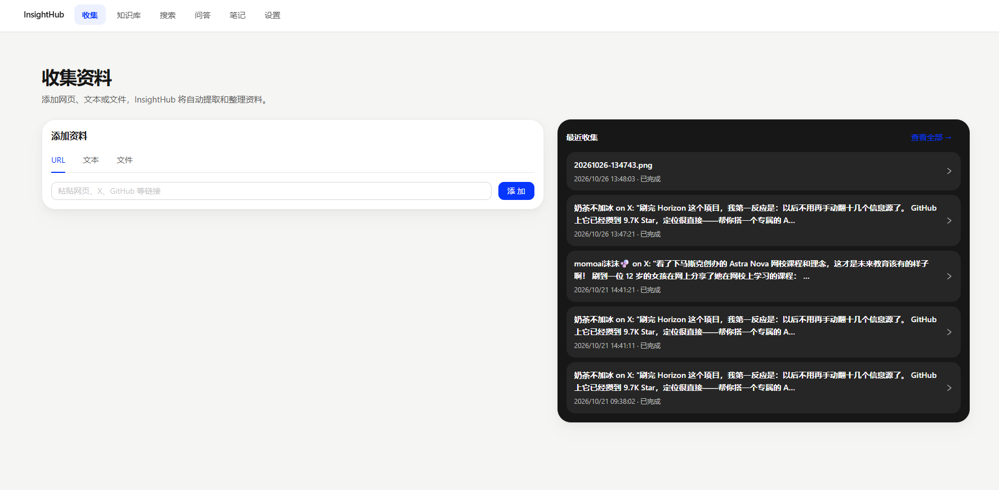
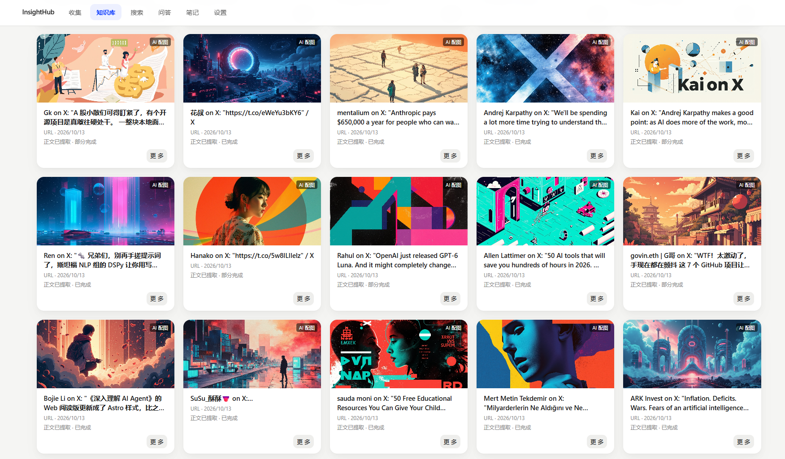
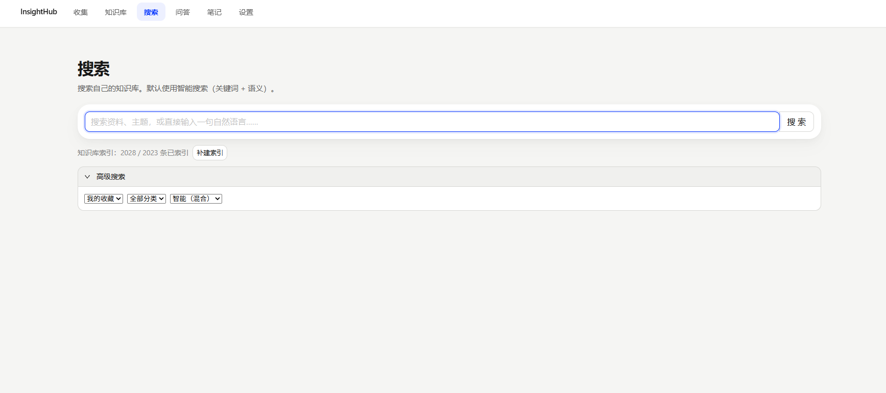
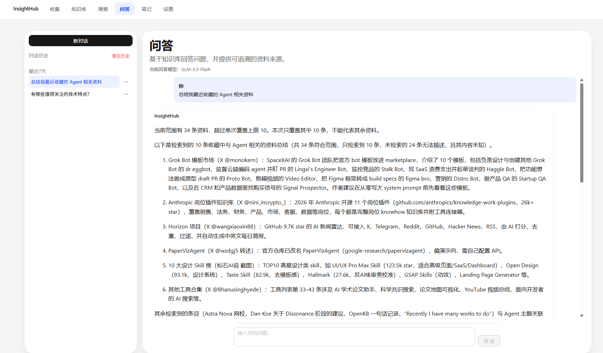
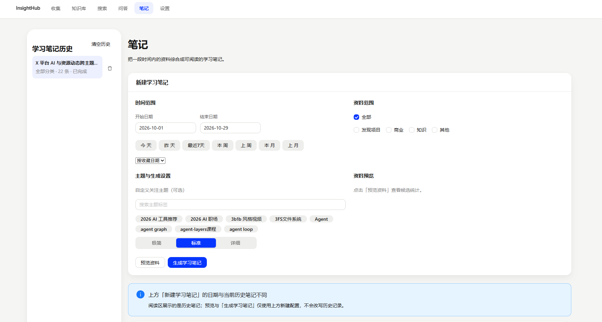
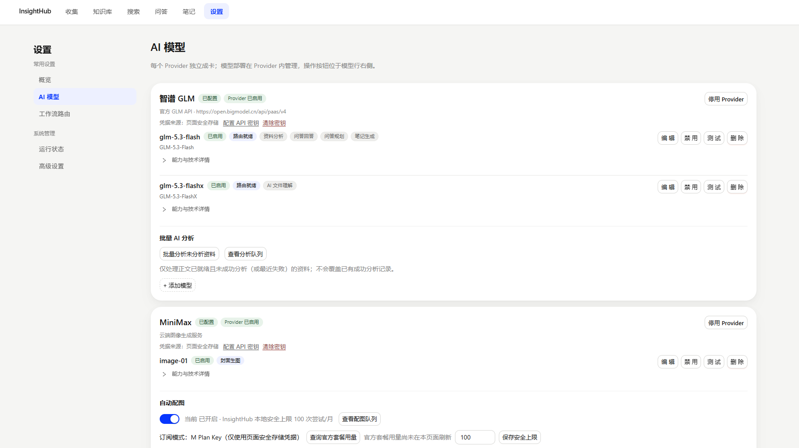
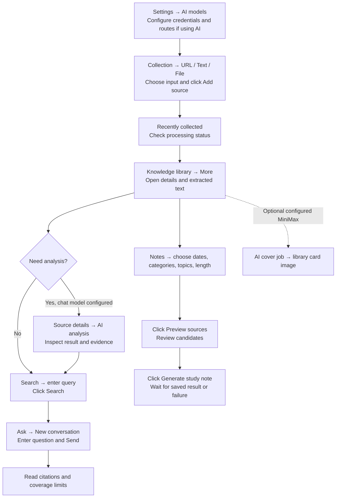
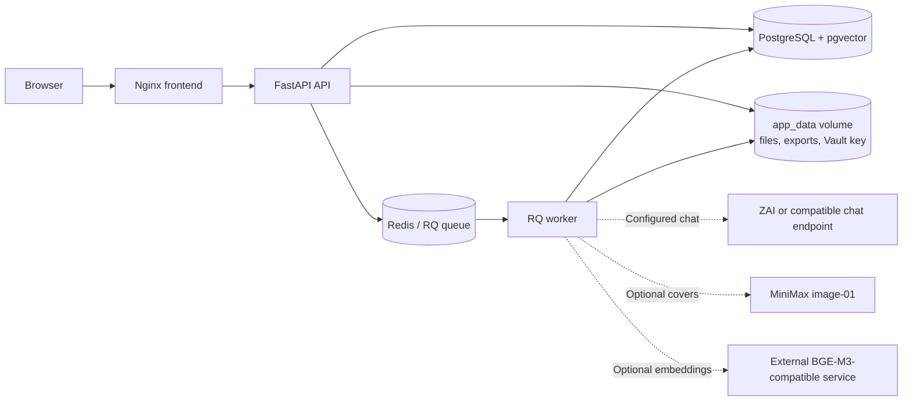

# InsightHub

**Turn saved links into a knowledge base you can search, question, and learn from.** InsightHub is a self-hosted workspace that connects collected sources, extracted content, AI analysis, search, answers, and study notes to their origins.

[简体中文](README.zh-CN.md) · [Docker install](docs/INSTALL.en.md) · [User guide](docs/USER-GUIDE.en.md) · [Model setup](docs/MODELS.en.md)

## Highlights

- **One place for scattered material.** Collect a URL, paste text, or upload a file; follow extraction status and revisit the original source.
- **Evidence you can inspect.** Source details keep extracted content and analysis together. Ask answers cite retrieved material and state coverage limits when the selected scope is larger than the retrieved set.
- **A path from reading to learning.** Search saved sources, ask questions, and preview a date or topic selection before generating a study note.
- **An optional visual library.** Knowledge cards can show AI-generated covers through MiniMax `image-01`. Image generation is separate from extraction and analysis, needs its own credentials, and may incur charges.
- **Self-hosted by default.** Docker Compose runs the web app, API, worker, PostgreSQL with pgvector, and Redis. Uploaded files, exports, and encrypted credentials live in persistent volumes.

## Product screenshots

These maintainer-provided screenshots show a configured, real-use instance captured on 2026-10-29. They contain saved material and third-party titles, not the synthetic Docker validation fixtures. They illustrate the UI rather than guarantee extraction of every external site or availability of any model account. No API key or Vault secret is visible.

### Collection — add a source and follow its status

Choose **URL**, **Text**, or **File**, click **Add source**, then check **Recently collected**. A submitted URL needs successful server-side extraction before its body becomes available.



### Knowledge library — browse sources and optional AI covers

Cards show saved sources and extraction status. Click **More** to inspect a source. The pictured covers were generated in the maintainer's configured instance; new installations do not generate covers automatically.



### Search — recover what you saved

Enter a phrase and click **Search**. **Advanced search** offers scope, category, and search mode. Keyword search works without an embedding service; semantic vector retrieval requires an external endpoint and an index.



### Ask — read answers with a coverage boundary

Click **New conversation**, enter a question, and send it. Ask uses retrieved sources and provides citations. The pictured answer explicitly says it retrieved 10 of 34 in-scope sources and does not speak for the other 24.



### Notes — turn a selected set into a study note

Choose dates, categories, optional topics, and length. Click **Preview sources** to review candidate counts, then **Generate study note**. Results and task status are kept in the history panel; generation requires a configured chat model.



### Settings — decide what each model does

**Settings → AI models** manages provider credentials, deployments, and workflow routes. This instance shows ZAI GLM for chat workflows and MiniMax for covers. Those credentials and entitlements are not bundled with the repository.



## From upload to useful output

The diagram names actual pages and actions. Processing may queue, partly succeed, or fail. See the [user guide](docs/USER-GUIDE.en.md) for details.



## System architecture



The [release Compose file](compose.release.yaml) defines the five services and three named volumes. BGE-M3 weights and its embedding server are **not bundled**. See [architecture](docs/ARCHITECTURE.md) and [deployment](docs/DEPLOYMENT.en.md).

## Quick install

1. Install Docker Engine and Compose v2, then download or clone this repository. Check the [English](docs/INSTALL.en.md) or [中文](docs/INSTALL.zh-CN.md) installation guide for requirements.
2. Copy `.env.docker.example` to `.env`. Set a strong URL-safe `POSTGRES_PASSWORD` and keep the file private.
3. Start and inspect the stack:

   ```sh
   docker compose -f compose.release.yaml up -d --build
   docker compose -f compose.release.yaml ps
   ```

4. When services are healthy, open <http://localhost:8080>. First build time depends on downloads and hardware. Collection and local storage can start without an AI key.

Back up PostgreSQL and `app_data` together; the latter includes files and the encrypted-credential master key material.

## AI model setup

| Capability | Configure | Without it |
|---|---|---|
| Analysis, Ask, study notes | In **Settings → AI models**, add a supported chat provider credential, deployment, and workflow route. Credentials use the encrypted Vault. | These AI workflows are unavailable; collection and local storage still work. |
| AI covers | Configure MiniMax `image-01`, review paid usage and the app's local attempt cap, then enable the desired cover workflow. | The library still works without generated covers. |
| Semantic retrieval | Run a separate OpenAI-compatible BGE-M3 embedding service and set its reachable URL, model, and key in `.env`. The index expects 1024-dimensional vectors. | Keyword search remains available. |

Provider access and model behavior depend on the operator's account and configuration. The [model guide](docs/MODELS.en.md) covers routes, privacy, and the BGE-M3 contract.

## Documentation

| Topic | English | 简体中文 |
|---|---|---|
| Docker Compose install | [Install](docs/INSTALL.en.md) | [安装指南](docs/INSTALL.zh-CN.md) |
| Windows local install | [Local install](docs/INSTALL-LOCAL.en.md) | [本机安装](docs/INSTALL-LOCAL.zh-CN.md) |
| Use the app | [User guide](docs/USER-GUIDE.en.md) | [使用指南](docs/USER-GUIDE.zh-CN.md) |
| Models and embeddings | [Models](docs/MODELS.en.md) | [模型与向量检索](docs/MODELS.zh-CN.md) |
| Deployment and backup | [Deployment](docs/DEPLOYMENT.en.md) | [部署运维](docs/DEPLOYMENT.zh-CN.md) |
| Troubleshooting | [Troubleshooting](docs/TROUBLESHOOTING.en.md) | [故障排查](docs/TROUBLESHOOTING.zh-CN.md) |
| Architecture | [Architecture](docs/ARCHITECTURE.md) | [架构说明](docs/ARCHITECTURE.md) |
| Development | [Development](docs/DEVELOPMENT.md) | [开发说明](docs/DEVELOPMENT.md) |
| Release | [v1.0.0 notes](docs/RELEASE-v1.0.0.md) | [更新记录](CHANGELOG.md) |

## License

InsightHub-authored code is licensed under [GNU AGPL-3.0-only](LICENSE). Use, modification, distribution, and hosting are subject to that license. Third-party components retain their own terms; see the [notices](docs/THIRD-PARTY-LICENSES.md).