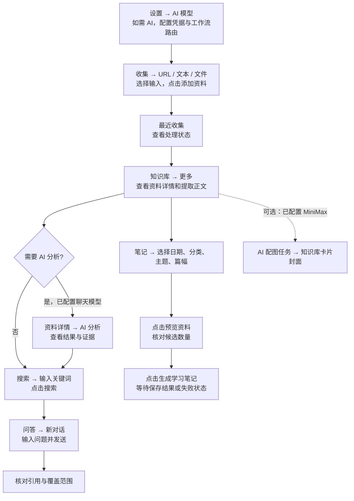
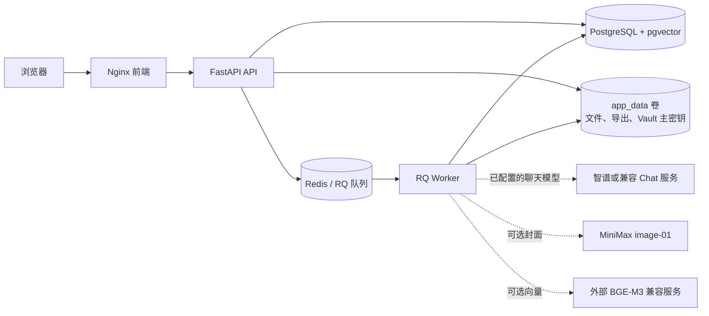

# InsightHub

**把随手收藏的链接，变成找得到、问得出、学得会的个人知识库。** InsightHub 是一套可自托管的研究与学习工作台，让资料收集、正文提取、AI 分析、检索问答和学习笔记始终关联到原始来源。

[English](README.md) · [Docker 安装](docs/INSTALL.zh-CN.md) · [使用指南](docs/USER-GUIDE.zh-CN.md) · [模型配置](docs/MODELS.zh-CN.md)

## 核心亮点

- **把分散资料收进同一个工作台。** 添加网址、粘贴文本或上传文件；跟踪提取状态，随时返回原始来源。
- **让答案有据可查。** 资料详情汇集提取正文与分析结果，问答引用检索到的资料；覆盖范围不足时明确说明，而不是把未检索的资料写成结论。
- **从阅读走向复盘。** 搜索收藏、提出问题，再按日期、分类和主题预览候选资料，生成学习笔记。
- **可选的视觉化知识库。** 知识库卡片可显示 MiniMax `image-01` 生成的 AI 封面。配图与正文提取、分析相互独立，需要单独配置，可能产生费用。
- **数据留在自己管理的部署中。** Docker Compose 提供前端、API、任务 Worker、PostgreSQL/pgvector 和 Redis；上传文件、导出文件与加密凭据保存在持久化卷中。

## 真实产品截图

以下是维护者提供的 2026-10-29 实际使用界面截图，展示已收藏资料及已配置的模型；不是此前的合成数据 Docker 验证截图。画面中的第三方标题和 AI 封面只用于展示界面，不代表所有外部网页均可成功提取，也不代表新安装实例已经拥有模型服务。截图未显示 API Key 或 Vault 密钥。

### 收集：输入资料，查看处理状态

在「收集」页选择「URL / 文本 / 文件」，点击「添加资料」，再到「最近收集」查看状态。提交 URL 后，仍需服务端成功提取，才能获得正文。


### 知识库：浏览资料与可选的 AI 配图

卡片展示资料及提取状态，点击「更多」查看详情。图中封面来自维护者已配置的实例；新安装默认不会自动生成配图。


### 搜索：把收藏重新找出来

输入关键词并点击「搜索」；「高级搜索」可选收藏范围、分类和搜索模式。没有 Embedding 服务时仍可使用关键词搜索；语义向量检索需要外部服务和相应索引。


### 问答：回答与检索范围一起呈现

点击「新对话」，输入问题并发送。问答基于检索资料生成带引用的回答。图中明确写出：范围内有 34 条资料，本次只检索 10 条；未检索的 24 条不被当作已知结论。


### 笔记：按自己的范围生成学习材料

选择日期、资料分类、可选主题和篇幅，先点击「预览资料」核对候选数量，再点击「生成学习笔记」。结果和任务状态保存在历史列表；生成需要已配置的聊天模型。


### 设置：让不同模型承担不同任务

在「设置 → AI 模型」管理 Provider 凭据、模型部署和工作流路由。图中实例配置了用于聊天工作流的智谱 GLM，以及用于封面的 MiniMax；仓库不附带这些凭据或账号权益。


## 从上传资料到形成知识

下图对应当前界面中的页面与按钮。后台处理可能排队、部分成功或失败；详细行为见[使用指南](docs/USER-GUIDE.zh-CN.md)。



## 系统架构



[发布 Compose 文件](compose.release.yaml)定义五项服务和三个命名卷。**BGE-M3 权重及其 Embedding 服务不在仓库或默认镜像中。**更多边界见[架构说明](docs/ARCHITECTURE.md)和[部署运维](docs/DEPLOYMENT.zh-CN.md)。

## Docker 快速安装

1. 安装 Docker Engine 和 Compose v2，下载或克隆本仓库。系统要求见[中文](docs/INSTALL.zh-CN.md)或[English](docs/INSTALL.en.md)安装指南。
2. 将 `.env.docker.example` 复制为 `.env`，设置强随机、适合 URL 的 `POSTGRES_PASSWORD`，并妥善保护该文件。
3. 启动并检查服务：

   ```sh
   docker compose -f compose.release.yaml up -d --build
   docker compose -f compose.release.yaml ps
   ```

4. 服务健康后打开 <http://localhost:8080>。首次构建时间取决于网络和硬件。没有 AI Key 也可启动收集与本地存储。

备份时应同时保护 PostgreSQL 与 `app_data`；后者包含文件和加密凭据主密钥材料。

## 按需配置 AI 模型

| 能力 | 需要配置 | 未配置时 |
|---|---|---|
| 分析、问答、学习笔记 | 在「设置 → AI 模型」配置支持的 Chat Provider 凭据、模型部署和工作流路由；凭据由加密 Vault 保存。 | 对应 AI 流程不可用；收集和本地保存仍可使用。 |
| AI 自动配图 | 配置 MiniMax `image-01`，核对付费额度与应用本地尝试上限，再启用所需配图流程。 | 知识库仍可使用，只是没有生成封面。 |
| 语义向量检索 | 单独部署 OpenAI 兼容的 BGE-M3 Embedding 服务，在 `.env` 配置容器可达地址、模型与 Key；当前索引要求 1024 维向量。 | 关键词搜索仍可使用。 |

模型权限与实际能力取决于运营者的账号和配置。路由、隐私边界及 BGE-M3 接口见[模型说明](docs/MODELS.zh-CN.md)。

## 完整文档导航

| 内容 | 简体中文 | English |
|---|---|---|
| Docker Compose 安装 | [安装指南](docs/INSTALL.zh-CN.md) | [Install](docs/INSTALL.en.md) |
| Windows 本机安装 | [本机安装](docs/INSTALL-LOCAL.zh-CN.md) | [Local install](docs/INSTALL-LOCAL.en.md) |
| 应用使用 | [使用指南](docs/USER-GUIDE.zh-CN.md) | [User guide](docs/USER-GUIDE.en.md) |
| AI 模型与向量检索 | [模型说明](docs/MODELS.zh-CN.md) | [Models](docs/MODELS.en.md) |
| 部署与备份 | [部署运维](docs/DEPLOYMENT.zh-CN.md) | [Deployment](docs/DEPLOYMENT.en.md) |
| 故障排查 | [故障排查](docs/TROUBLESHOOTING.zh-CN.md) | [Troubleshooting](docs/TROUBLESHOOTING.en.md) |
| 系统架构 | [架构说明](docs/ARCHITECTURE.md) | [Architecture](docs/ARCHITECTURE.md) |
| 开发 | [开发说明](docs/DEVELOPMENT.md) | [Development](docs/DEVELOPMENT.md) |
| 发布 | [更新记录](CHANGELOG.md) | [v1.0.0 notes](docs/RELEASE-v1.0.0.md) |

## License

InsightHub 自有代码采用 [GNU AGPL-3.0-only](LICENSE)。使用、修改、分发及网络服务均须遵守许可证；第三方组件适用各自条款，见[第三方许可说明](docs/THIRD-PARTY-LICENSES.md)。