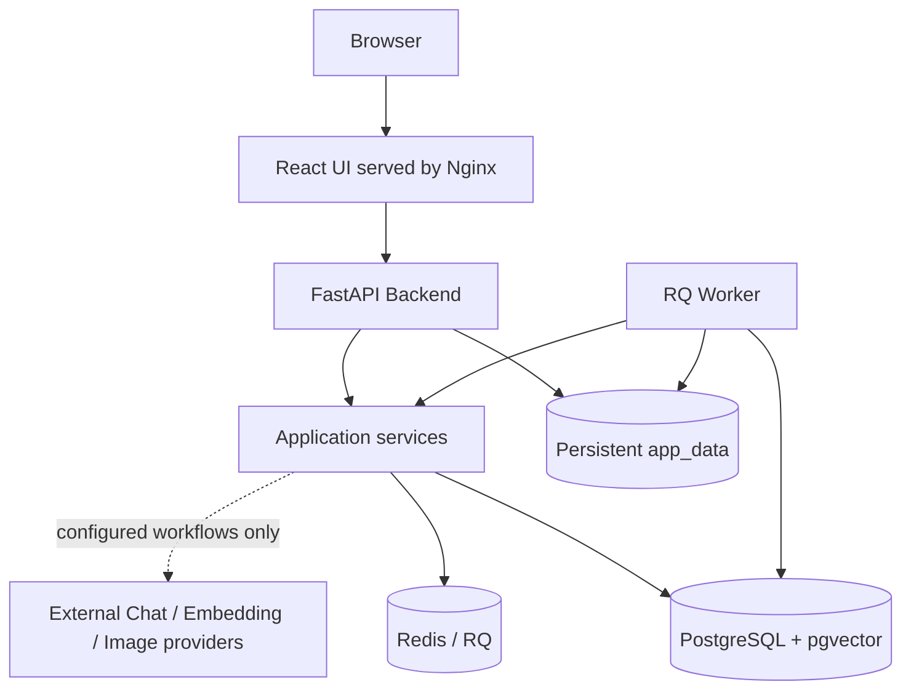
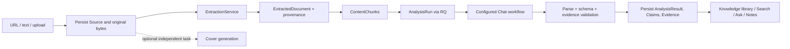
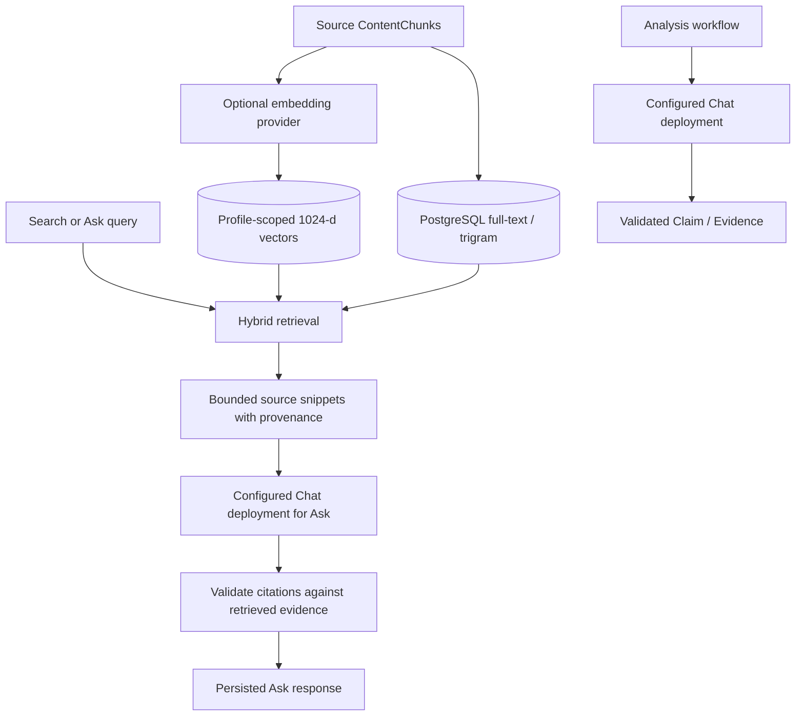
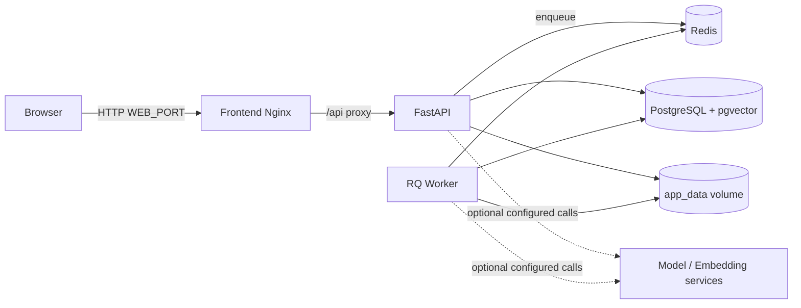

# Architecture

## Architecture at a glance

The source-editable Mermaid files are in [`docs/diagrams/`](diagrams/architecture.mmd). Optional provider edges are active only when configured and routed; external models are not bundled.



### Source to evidence



### Models and retrieval



### Docker deployment



目标运行时：

```text
Browser
↓
React Frontend
↓
FastAPI
↓
Application Services
├─ Ingestion
├─ Extraction
├─ Source Resolution
├─ Dedup
├─ LLM
├─ Retrieval
├─ Synthesis
└─ Brief
↓
PostgreSQL + pgvector
Redis / RQ
Local File Storage
```

## Boundaries in M7

Brief 只消费已经完成的 Analysis。它不自动触发分析，也不把综合句写回 Claim。主选资料来自 USER_COLLECTION 的 collected_at 或可靠 published_at。当前 Analysis 为 SUCCEEDED 或 PARTIAL 的资料都可以进入综合。上下文预算使用当前 Provider 的 context window，没有单独声明时才退回默认窗口。综合请求附带 Brief JSON schema，引用必须回指该 Claim 自己的 Evidence。已选资料若没有进入通过校验的综合，会记为 NOT_CITED，而不是继续算作 included。综合任务的队列超时长于单次模型超时；生成中断时 Brief 记为 FAILED，不停留在 RUNNING。Source Index 的 URL 由数据库生成。导出文件写到 `data/exports/`，可以重新生成。定时 Brief 不属于 M7。

## Boundaries in M6

检索语料是当前 ExtractedDocument 的 ContentChunk。FTS、pg_trgm 和 pgvector 都在同一 PostgreSQL 中。EmbeddingProvider 与 LLMProvider 分开。M6 v1 只有一个 active embedding profile，向量列固定为 `vector(1024)`。Search 不调用生成模型。Ask 每次重新检索，引用必须落在本次上下文里的原文 quote。提问会先区分两种检索：聚焦问题沿用混合检索和向量距离门槛，找最相关分段；概括、枚举或比较当前范围内的资料时，改为按资料覆盖，为每条有正文的资料选取代表分段，而不是只保留全局最相似的几段。单次覆盖有上限。回答不能把一条资料的证据说成其他未检索资料的结论。SENSITIVE 资料不能送给云端 embedding 或云端 Ask。Ask 回答不进入长期知识库。

Ask Answer 的 token streaming 是体验层能力：创建 turn 仍由 RQ Worker 执行 Planner → 检索 → Answer；Answer 在 `supports_streaming=true` 的 deployment 上走 OpenAI-compatible `stream=true`，Worker 将阶段性事件与 `delta` 写入 Redis Stream（`insighthub:ask:stream:{turn_id}`，TTL 可配置），浏览器通过 `GET /api/ask/turns/{turn_id}/events` 订阅 SSE。流式正文是 provisional draft；只有 citation validation 完成并持久化到 `AskTurn` 后的 `final` 事件（及 DB 中的 `answer_markdown` / `AskCitation`）才是正式结果。

## Boundaries in M5

M5 读取当前 AnalysisResult，写入 OrganizationRun 和正式分类关系。KnowledgeCard、CommercialInsight、ProjectCandidate 只保存标题、摘要快照，以及指向原 Claim 的链接。证据仍走 Claim → Evidence → ContentChunk。组织过程不调用模型。用户的类别、主题、标签和项目升级不会被下一次 organize 覆盖。新的当前 Analysis 可以再次 organize；写入新的系统主分类前，会先放开上一轮系统主分类的 is_primary。

## M-PIPELINE-R7 provider and extraction boundaries

- `ZAI` is a distinct official provider identity using `https://open.bigmodel.cn/api/paas/v4`; `glm-5.3-flash` and `glm-5.3-flashx` deployments are separate. `EXTRACTION_AI` is a configurable FlashX candidate route. The existing database routes are not rewritten at startup; the guarded cutover requires a ZAI key, successful Chat/JSON Object/streaming probes, and an idle queue.
- GLM-5.3 Flash/FlashX requests always send `thinking.type=enabled`; final `content` is consumed as the answer, while `reasoning_content`, finish reason, and usage details remain separate metadata. JSON Object still goes through the existing schema and evidence validation.
- Zhipu Prime Sync parsing is opt-in (`ZAI_FILE_PARSER_ENABLED=false` by default), runs from the RQ extraction job, and never receives SENSITIVE inputs. Original file bytes remain in `data/raw`. Local PDF/DOCX/OCR parsing remains the private/offline path. Video upload is not currently implemented because the supported input contract and location semantics have not been validated end to end.
- `ExtractionService` remains the shared input dispatcher. Web/X fetch, SSRF checks, browser fallback, source persistence, and chunking are retained. SENSITIVE chat analysis remains local-only per RULE-009.

## Boundaries in M4

M4 只分析已经提取成功或部分成功的单个 Source。

- `LLMProviderConfig` 表示提供方账号/端点（Base URL、API key 环境变量名、是否本地）。`LLMModelDeployment` 表示该端点下的具体模型（`model_id`、能力、上下文窗口等）。DeepSeek、SiliconFlow、LM Studio 和通用 OpenAI-compatible 接口共用同一套 chat completions 传输。
- API key 只在提供方层，通过环境变量名引用，不写入数据库，不返回前端，也不复制到每个 deployment。
- Analysis、Ask Planner、Ask Answer、Brief 各自读取 `llm_workflow_routes`，路由目标是 `deployment_id`，不是 `provider_type`。Settings 中为每个提供方维护多个 model deployment。新增云端模型不必改 `.env` 或重启服务。本地失败不会自动改用云端。只有测试开关 `LLM_ENABLE_FAKE` 且默认提供方是 `FAKE` 时，自动化测试才绕过已保存的路由。
- **运行时能力以 deployment 为准**：`LLMModelDeployment.capabilities_json`（`supports_json_schema` / `supports_json_object` / `supports_streaming` 等）决定结构化工作流是否可用；提供方层的 capability 只是 bootstrap 提示，不能覆盖 deployment。Settings 的 **Test Model** 会对每个 deployment 做最小 probe（Chat、UTF-8、`json_object`、`json_schema`、streaming），返回 `SUPPORTED` / `UNSUPPORTED` / `UNKNOWN` / `TRANSIENT_FAILURE`；只有明确结果会写回 deployment。`429`/`5xx`/超时不会把能力记为不支持。`context_window` 等仍由用户声明，probe 不猜测。
- Embedding 继续走本地 BGE-M3，不进入聊天路由。
- 新分析使用 `prompts/source_analysis/v1.1.0/`，版本 `source_analysis` `1.1.0`。`v1/` 的 `1.0.0` 保持不变，历史 AnalysisRun 仍记录 `1.0.0`。
- `AnalysisRun` 不覆盖历史。FACT 和 SOURCE_CLAIM 没有通过校验的 Evidence 时不会入库，run 标为 PARTIAL。
- SENSITIVE 资料只能使用本机地址上的 `LOCAL_OPENAI_COMPATIBLE` 或测试用 Fake provider。
- 长文按上下文预算分组，最终证据仍指向原始 `ContentChunk`。
- 不创建 Category、Topic、Entity、KnowledgeCard、Project 或向量索引。

## Boundaries in M3

M3 在已收集资料上寻找可能的原始来源。用户提交的 Source 身份保持不变。

- `backend/app/services/discovery` 提供 URL、图片 OCR 文本、粘贴文本和标识符解析。API 不直接调用搜索或 HTML 库。
- 找到 URL 时只写 `OriginalSourceCandidate`。用户确认后才创建或复用 URL `SourceItem`，并写 `SourceRelation(RESOLVES_TO)`。
- `IngestionRecord.origin` 区分 `USER_COLLECTION` 与 `SYSTEM_DISCOVERY`。系统发现的 URL 不是用户当天主动收藏。
- 搜索通过 `SearchProvider`。默认 DuckDuckGo HTML 是 best-effort，没有 SLA。可换成 `SEARCH_PROVIDER=http` 或 `disabled`。
- 发现任务进入 RQ 队列 `insighthub`。搜索失败只让 DiscoveryRun 失败，不改 ingestion 或 extraction。
- 候选抓取和手动 URL 复用 M2 SSRF 策略。网页标题、摘要和正文仍是不可信数据。
- 搜索摘要不写入 Claim、Evidence 或 Knowledge。
- 确认后的新 URL 可以排队提取。关系成功不代表提取成功。
- 不自动确认搜索结果。M3 不使用 LLM。
- `llm`、`retrieval`、`synthesis`、`briefs` 仍是预留包。

## Boundaries in M2

M2 在 M1 Inbox 上提取正文和结构块，不寻找原始出处，也不做向量或模型分析。

- `backend/app/api` 提供健康检查、摄入、Inbox、资料详情，以及 `/api/sources/{id}/extract`、`/reextract`、`/extraction`。
- `backend/app/services/ingestion` 仍只负责接收、保存和精确去重。
- `backend/app/services/extraction` 把 TEXT、Markdown、DOCX、PDF、图片 OCR 和已知 URL 转成 `ExtractionRun`、`ExtractedDocument` 与 `ContentChunk`。
- PDF、图片、DOCX 和网页提取通过 Redis RQ 队列 `insighthub` 执行。文本和 Markdown 在请求内完成。
- 网页获取 **先** 用静态 HTTP（跟随重定向、不执行 JavaScript）。`web_quality.py` 对登录墙、X/Twitter 导航壳、JS-heavy 空壳等做确定性质量判断；需要时标记 `NEEDS_BROWSER_EXTRACTION` 或 `WEB_AUTH_OR_CHALLENGE`，再由 RQ worker 按需启动 **Playwright Chromium** 渲染 DOM，并复用同一套 `web-v1` HTML 正文解析。浏览器不是默认 fetcher；`WEB_BROWSER_FALLBACK_ENABLED=false` 时保持原失败语义。出站 URL / 重定向 / 子资源请求均走 SSRF 策略（见 `docs/PILOT_04_BROWSER_SECURITY.md`）。Chromium 未安装时不影响 `/ready`；仅在实际 fallback 时返回 `BROWSER_RUNTIME_UNAVAILABLE`。
- `scripts/manage.ps1`（及根目录 `启动InsightHub.bat`）负责本地一键启动/停止/状态/诊断；`start.ps1` / `stop.ps1` 转发到 manage。默认 `stop` 不关闭 Docker 卷。`scripts/run_worker.ps1` 仍可单独启动 RQ worker。`dev_up.ps1` 仍然只启动 PostgreSQL 和 Redis。
- `source_resolution` 转发到 `DiscoveryService`。`llm`、`retrieval`、`synthesis`、`briefs` 仍是预留包。
- `backend/app/db` 注册 M1、M2 和 M3 的发现表。
- `frontend` Inbox 显示解析状态。详情同时保留来源元数据和提取正文。
- 原始文件只进入 `data/raw`。OCR 页图进入 `data/extracted`。
- `prompts/` 仍是未来版本化提示词目录。
- 原始文件只进入 `data/raw/<aa>/<bb>/<sha256>.bin`。数据库保存相对路径和原始文件名，不保存文件字节。
- PostgreSQL 17 + pgvector 与 Redis 由根目录 `docker-compose.yml` 提供。容器内端口仍是 5432 与 6379。

## Frozen stack

```text
Python 3.11
FastAPI
Uvicorn
SQLAlchemy 2.x
Alembic
Pydantic 2.x
psycopg
React + TypeScript + Vite + Ant Design
PostgreSQL 17 + pgvector
Redis + RQ
Local filesystem
```

第一版不引入 Elasticsearch、Milvus、Qdrant、MongoDB、MinIO、S3、Redux、Next.js 或微服务拆分。

v1.0 增加本地可靠性层：`GET /health` 只表示进程存活并返回版本 `1.0.0`，`GET /ready` 检查 PostgreSQL、Redis 和 Alembic revision。外部模型不可达不会让系统变为 not ready。备份通过 `docker exec` 调用 `pg_dump`，原始文件按相对路径复制。日志写到 `data/logs/`，按大小轮转，并去掉密钥。
